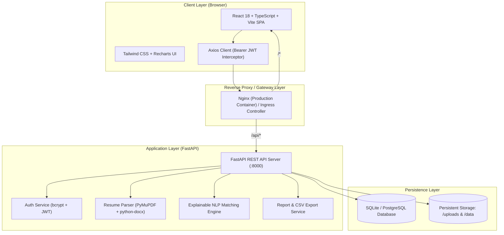
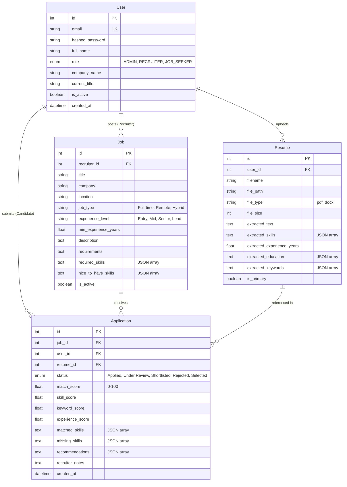

# TalentMatch AI – AI-Based Resume Screening and Job Recommendation Portal

[](https://fastapi.tiangolo.com)
[](https://react.dev)
[](https://www.typescriptlang.org)
[](https://tailwindcss.com)
[](https://www.docker.com)
[](https://kubernetes.io)
[](LICENSE)

**TalentMatch AI** is an enterprise-grade AI Resume Screening and Job Recommendation SaaS portal. Inspired by the workflow and transparency of modern ATS optimization tools (such as Jobscan), TalentMatch AI provides candidates with explainable ATS match scoring and empowers recruiters with a streamlined, AI-assisted screening pipeline.

> [!NOTE]
> **Zero Black-Box Mystery:** TalentMatch AI explicitly rejects opaque black-box machine learning scoring. Every match percentage is driven by a mathematically verified and explainable Natural Language Processing (NLP) pipeline based on technical skill overlap, TF-IDF cosine similarity, and experience parity.

---

## Table of Contents

1. [Project Objectives](#1-project-objectives)
2. [Key Capabilities & 12 Mandatory Screens](#2-key-capabilities--12-mandatory-screens)
3. [System Architecture](#3-system-architecture)
4. [Explainable AI / NLP Matching Engine](#4-explainable-ai--nlp-matching-engine)
5. [Technology Stack](#5-technology-stack)
6. [Folder Structure](#6-folder-structure)
7. [Database Schema Design](#7-database-schema-design)
8. [Local Execution Instructions](#8-local-execution-instructions)
9. [Docker & Docker Compose Deployment](#9-docker--docker-compose-deployment)
10. [Kubernetes Deployment Guide (Minikube / Kind)](#10-kubernetes-deployment-guide-minikube--kind)
11. [REST API Documentation](#11-rest-api-documentation)
12. [Four Mandatory Functional Reports](#12-four-mandatory-functional-reports)
13. [Demonstration Credentials](#13-demonstration-credentials)
14. [Testing Suite](#14-testing-suite)

---

## 1. Project Objectives

- **Explainable Resume Optimization:** Enable job seekers to analyze their PDF or DOCX resumes against target job descriptions with actionable recommendations.
- **Automated Recruiter Screening:** Provide hiring managers with instant candidate ranking, matched technical skills, and identified talent gaps.
- **Multi-Role Access Control (RBAC):** Distinct dashboards, navigation, and permissions for `ADMIN`, `RECRUITER`, and `JOB_SEEKER`.
- **End-to-End DevOps Lifecycle:** Fully containerized with multi-stage Dockerfiles, Docker Compose with health checks, and production Kubernetes manifests with readiness/liveness probes and persistent storage.
- **Open-Source & Free:** Built entirely with free and open-source tools—no paid or proprietary third-party APIs required.

---

## 2. Key Capabilities & 12 Mandatory Screens

The application includes 12 responsive, role-tailored screens:

| # | Screen | URL Route | Description |
| :-: | :--- | :--- | :--- |
| **1** | **Landing Page** | `/` | Hero showcase, ATS feature comparison, and 1-click evaluation demo buttons. |
| **2** | **Authentication** | `/login`, `/register` | JWT auth with instant 1-click demo role switching and role selection. |
| **3** | **Job Seeker Dashboard** | `/dashboard` | Metric summary cards, primary resume profile, skills chips, and live application pipeline. |
| **4** | **Resume Upload** | `/dashboard/resumes` | Drag-and-drop PDF/DOCX file uploader, size/type validation, structured skill/education extraction, and raw text preview. |
| **5** | **Resume Analysis & Matcher** | `/matcher` | Circular SVG score gauge, 50/30/20 factor breakdown, matched/missing skills chips, keyword frequency table, and actionable recommendations. |
| **6** | **Job Recommendations** | `/dashboard/recommendations` | Jobs ranked against candidate's primary resume with ATS compatibility pills and Easy Apply modal. |
| **7** | **Job Search & Board** | `/jobs` | Searchable job board with filters for title, location, job type, and experience level. |
| **8** | **Recruiter Dashboard** | `/recruiter` | Requisition overview, applicant volume, shortlisted candidates count, and ranked submissions table. |
| **9** | **Manage Job Postings** | `/recruiter/jobs` | Requisition creation/editing modal with customized technical skills taxonomy. |
| **10** | **Candidate Management** | `/recruiter/candidates` | Applicant screening list, resume inspection modal, and 5-stage status workflow (Applied, Under Review, Shortlisted, Selected, Rejected). |
| **11** | **Admin Dashboard** | `/admin` | System user directory, role management, user activation toggle, and platform metrics. |
| **12** | **Reports & Analytics** | `/admin/reports` | 4 functional compliance reports with Recharts visualizations and 1-click CSV data export. |

---

## 3. System Architecture



---

## 4. Explainable AI / NLP Matching Engine

TalentMatch AI uses an explainable Natural Language Processing matching methodology.

### Scoring Formula

$$\text{Overall Score} = (\text{Skill Score} \times 0.50) + (\text{Keyword Score} \times 0.30) + (\text{Experience Score} \times 0.20)$$

```
┌────────────────────────────────────────────────────────────────────────┐
│                      TOTAL ATS MATCH SCORE (0-100)                     │
└───────────────────────────────────┬────────────────────────────────────┘
                                    │
         ┌──────────────────────────┼──────────────────────────┐
         │ (50% Weight)             │ (30% Weight)             │ (20% Weight)
         ▼                          ▼                          ▼
┌──────────────────┐       ┌──────────────────┐       ┌──────────────────┐
│   SKILL MATCH    │       │  KEYWORD DENSITY │       │ EXPERIENCE MATCH │
│  Jaccard overlap │       │  TF-IDF Vector   │       │ Candidate years  │
│  with required & │       │Cosine Similarity │       │  vs min required │
│   nice skills    │       │& frequency check │       │  qualification   │
└──────────────────┘       └──────────────────┘       └──────────────────┘
```

1. **Skill Matching (50% Weight):**
   - Exact and boundary-safe regex matching against a comprehensive taxonomy of programming languages, frameworks, databases, cloud platforms, and DevOps tools.
   - Required skills carry 80% of the skill component, while nice-to-have skills carry 20%.
2. **Keyword & Semantic Matching (30% Weight):**
   - Employs **Scikit-Learn's `TfidfVectorizer`** (1-gram and 2-gram n-grams, English stopwords removal) to build vector representations of both documents.
   - Computes **Cosine Similarity** between the resume and job description matrices.
   - Measures occurrence frequency for top domain terms.
3. **Experience Duration Matching (20% Weight):**
   - Evaluates detected candidate experience years against the job requisition's minimum required experience.
   - If candidate years $\ge$ required years, 100% score is awarded; partial credit is awarded proportionally if within range.

---

## 5. Technology Stack

### Frontend
- **React 18** with **TypeScript**
- **Vite** build tool
- **Tailwind CSS** (clean SaaS theme: slate background, dark navy typography `#0f172a`, indigo/purple accents `#6366f1`)
- **React Router v6** for protected, role-gated navigation
- **Recharts** for interactive bar charts, pie charts, and trend metrics
- **Lucide React** for clean icon set
- **Axios** with automatic JWT Bearer token interceptor

### Backend
- **Python 3.12**
- **FastAPI** with auto-generated OpenAPI / Swagger docs
- **SQLAlchemy 2.0** ORM
- **Pydantic v2** data validation and schemas
- **PyMuPDF (fitz)** for high-fidelity PDF text extraction
- **python-docx** for DOCX parsing
- **Scikit-Learn** & **NumPy** for TF-IDF vectorization and cosine similarity
- **Bcrypt** & **Python-Jose** for password hashing and JWT issuance

### Database & Storage
- **SQLite 3** for instant zero-dependency local development
- Flexible SQLAlchemy database configuration compatible with **PostgreSQL** via environment variables
- Persistent volume storage for uploaded resumes

### DevOps & Infrastructure
- **Docker**: Multi-stage Nginx frontend container and lightweight Python 3.12-slim backend container
- **Docker Compose**: Orchestrates frontend, backend, health checks, volumes, and networks
- **Kubernetes (k8s/)**: Complete manifests for Deployments, Services, ConfigMaps, Secrets, PVCs, and Ingress
- **Minikube & Kind** compatible

---

## 6. Folder Structure

```
talentmatch-ai/
├── backend/
│   ├── app/
│   │   ├── models/           # SQLAlchemy ORM models (User, Resume, Job, Application)
│   │   ├── routers/          # FastAPI routers (auth, users, resumes, jobs, applications, analytics)
│   │   ├── schemas/          # Pydantic v2 validation models
│   │   ├── services/         # Business logic (auth_service, resume_parser, matching_service, report_service)
│   │   ├── config.py         # Application configuration & weights
│   │   ├── database.py       # SQLAlchemy engine & session dependency
│   │   ├── main.py           # FastAPI entrypoint, middleware, and table creation
│   │   └── seed_data.py      # Database seeder with realistic initial records
│   ├── tests/                # Automated pytest API test suite
│   ├── Dockerfile            # Production backend Docker image
│   ├── .dockerignore
│   └── requirements.txt      # Python dependencies
├── frontend/
│   ├── src/
│   │   ├── components/       # Layouts, Navbar, Sidebar, ScoreMeter, Badges, Modals
│   │   ├── context/          # AuthContext (JWT & demo switcher), ToastContext
│   │   ├── pages/            # 12 application screens
│   │   ├── services/         # Axios API client
│   │   ├── types/            # TypeScript data contracts
│   │   ├── App.tsx           # Route definitions & protected route wrappers
│   │   ├── main.tsx          # React application root
│   │   └── index.css         # Tailwind directives & custom scrollbars
│   ├── Dockerfile            # Multi-stage production Nginx frontend image
│   ├── nginx.conf            # Custom Nginx reverse proxy configuration
│   ├── package.json
│   ├── tailwind.config.js
│   └── vite.config.ts
├── k8s/
│   ├── namespace.yaml
│   ├── configmap.yaml
│   ├── secret-template.yaml
│   ├── persistent-volume-claim.yaml
│   ├── backend-deployment.yaml
│   ├── backend-service.yaml
│   ├── frontend-deployment.yaml
│   ├── frontend-service.yaml
│   ├── ingress.yaml
│   └── kustomization.yaml
├── docker-compose.yml        # Multi-container local orchestration
├── .env.example              # Environment variables template
├── .gitignore
├── PROJECT_STATUS.md         # Phase verification log
└── README.md
```

---

## 7. Database Schema Design



---

## 8. Local Execution Instructions

### Prerequisites
- Python 3.12+ installed
- Node.js 18+ and npm installed
- Git installed

### 1. Clone & Set Up Backend

```bash
# Navigate to project root
cd d:\DEVv

# Create Python virtual environment
cd backend
py -3.12 -m venv venv

# Activate virtual environment
# Windows PowerShell:
.\venv\Scripts\Activate.ps1
# Windows CMD:
.\venv\Scripts\activate.bat
# Linux/macOS:
source venv/bin/activate

# Install dependencies
pip install -r requirements.txt

# Run backend server
python -m uvicorn app.main:app --host 127.0.0.1 --port 8000 --reload
```

The backend server starts at `http://127.0.0.1:8000`.
- API Health Check: `http://127.0.0.1:8000/api/health`
- Interactive Swagger UI: `http://127.0.0.1:8000/docs`

### 2. Set Up Frontend

In a separate terminal:

```bash
cd d:\DEVv\frontend

# Install node dependencies
npm install

# Start Vite development server
npm run dev
```

The frontend will run at `http://localhost:5173`. Open your browser and navigate to this URL.

---

## 9. Docker & Docker Compose Deployment

### Running with Docker Compose

Run the complete multi-tier application with a single command:

```bash
# From project root directory:
docker-compose up -d --build
```

### Inspecting Container Status

```bash
# View running containers and health checks:
docker-compose ps

# Follow application logs:
docker-compose logs -f
```

- **Frontend Application:** `http://localhost:3000`
- **Backend API:** `http://localhost:8000`
- **API Swagger Documentation:** `http://localhost:8000/docs`

To stop the containers:

```bash
docker-compose down
```

---

## 10. Kubernetes Deployment Guide (Minikube / Kind)

The `k8s/` directory contains complete Kubernetes manifests with isolated namespaces, persistent volumes, environment configs, and health probes.

### Deploying to Minikube

```bash
# 1. Start Minikube
minikube start

# 2. Build Docker images inside Minikube's Docker daemon
minikube image build -t talentmatch-backend:latest ./backend
minikube image build -t talentmatch-frontend:latest ./frontend

# 3. Apply all Kubernetes manifests using Kustomize
kubectl apply -k k8s/

# 4. Verify deployment rollouts
kubectl get pods -n talentmatch
kubectl get services -n talentmatch
kubectl get pvc -n talentmatch

# 5. Access the Frontend Service
minikube service talentmatch-frontend -n talentmatch
```

### Testing Manifests via Dry-Run

You can validate manifest syntax without an active cluster:

```bash
kubectl kustomize k8s
```

---

## 11. REST API Documentation

### Authentication Endpoints
- `POST /api/auth/register` – Register a new user (`JOB_SEEKER` or `RECRUITER`)
- `POST /api/auth/login` – Login with JSON payload and receive JWT
- `POST /api/auth/token` – OAuth2 form-data authentication endpoint
- `GET /api/auth/me` – Retrieve profile for authenticated user
- `PUT /api/auth/me` – Update user profile

### Resume Endpoints
- `POST /api/resumes/upload` – Upload PDF/DOCX file and extract skills, experience, and keywords
- `GET /api/resumes/` – List uploaded resumes
- `GET /api/resumes/{id}` – View resume extracted details and raw text
- `DELETE /api/resumes/{id}` – Delete resume and file from disk
- `POST /api/resumes/analyze` – Explainable NLP comparison between resume text and job description

### Job Requisition Endpoints
- `GET /api/jobs/` – Browse and search active jobs with filters (location, type, level, skill)
- `GET /api/jobs/{id}` – View job details
- `POST /api/jobs/` – Create job requisition (*Recruiter / Admin*)
- `PUT /api/jobs/{id}` – Update job requisition (*Recruiter / Admin*)
- `DELETE /api/jobs/{id}` – Delete job requisition (*Recruiter / Admin*)
- `GET /api/jobs/recommendations/me` – Retrieve ranked job recommendations based on candidate's primary resume

### Application Tracking Endpoints
- `POST /api/applications/` – Submit application (computes AI match score; prevents duplicates)
- `GET /api/applications/my` – Candidate's application tracking history
- `GET /api/applications/{id}` – Retrieve application detail and full score breakdown
- `PATCH /api/applications/{id}/status` – Update hiring status (*Recruiter / Admin*)

### Analytics & Reports Endpoints
- `GET /api/analytics/overview` – Role-based summary KPIs
- `GET /api/analytics/reports/resume-screening?format=csv` – Report 1
- `GET /api/analytics/reports/candidate-skills?format=csv` – Report 2
- `GET /api/analytics/reports/job-applications?format=csv` – Report 3
- `GET /api/analytics/reports/recruitment-summary?format=csv` – Report 4

---

## 12. Four Mandatory Functional Reports

Accessible under **Reports & Analytics** (`/admin/reports` or `/recruiter/reports`):

1. **Resume Screening Report:**
   - Candidate full name, email, target position, calculated match score (0-100%).
   - Lists of matched technical skills, missing skills, and actionable recommendations.
   - 1-click CSV download.
2. **Candidate Skill Analysis Report:**
   - Bar chart of most common skills across the candidate pool.
   - Bar chart of in-demand skills required across active job postings.
   - Identified talent skill gap table.
   - 1-click CSV download.
3. **Job Application Report:**
   - Log of all submissions with job title, company, candidate info, status, match score, and timestamps.
   - 1-click CSV download.
4. **Recruitment Summary Report:**
   - Total jobs, active requisitions, total applications, and average match score.
   - Interactive Recharts pie chart showing distribution across pipeline stages.
   - Top requisitions by applicant demand.
   - 1-click CSV download.

---

## 13. Demonstration Credentials

The database seeds automatically with demo accounts on first startup. All accounts share password: `talentmatch123`.

| Role | Email | Password | Full Name | Context |
| :--- | :--- | :--- | :--- | :--- |
| **ADMIN** | `admin@talentmatch.ai` | `talentmatch123` | Alex Vance | Platform administrator |
| **RECRUITER** | `sarah.recruiter@cloudtech.com` | `talentmatch123` | Sarah Jenkins | CloudScale Technologies recruiter |
| **RECRUITER** | `david.talent@apexai.io` | `talentmatch123` | David Patel | Apex AI Labs recruiter |
| **JOB SEEKER** | `elena.dev@gmail.com` | `talentmatch123` | Elena Rostova | Senior Full Stack candidate |
| **JOB SEEKER** | `marcus.cloud@outlook.com` | `talentmatch123` | Marcus Brody | DevOps Engineer candidate |

> [!TIP]
> Use the **"Demo Switch"** dropdown in the top navigation bar or the fast-login buttons on the login screen to switch between roles in one click.

---

## 14. Testing Suite

### Running Automated Backend Tests

```bash
cd backend
.\venv\Scripts\python.exe -m pytest -v
```

**Test Coverage Highlights:**
- `test_health_check`: Verifies API health and database connectivity.
- `test_login_demo_admin`: Verifies Admin JWT issuance and role check.
- `test_login_demo_recruiter`: Verifies Recruiter authentication.
- `test_login_demo_job_seeker`: Verifies Candidate authentication.
- `test_register_new_candidate`: Verifies unique user registration and password hashing.
- `test_jobs_list_public`: Verifies public job listings and schema.
- `test_analyze_resume_endpoint`: Verifies explainable NLP matching calculation, 0-100 score bounds, breakdown, and recommendations.
- `test_admin_reports`: Verifies all 4 reporting endpoints.

### Frontend Production Build Verification

```bash
cd frontend
npm run build
```

Compiles TypeScript cleanly with zero errors to produce production assets in `frontend/dist/`.
