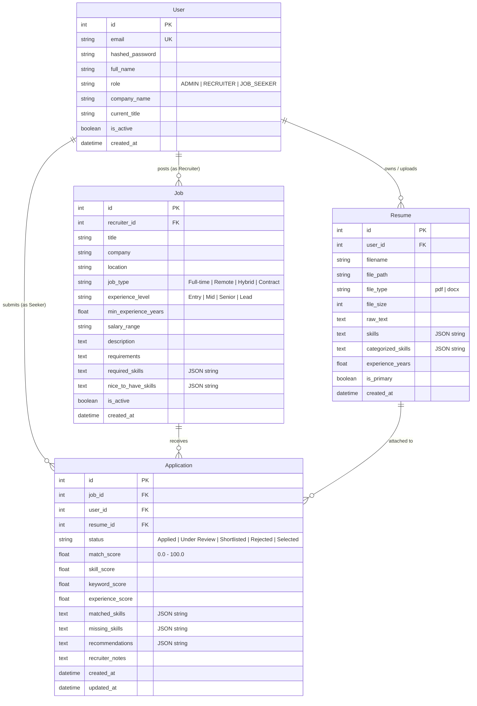

# HireMatch AI – AI-Powered Resume Screening & Job Recommendation Portal

[](https://github.com/Induvardhan116/HireMatch-AI)
[](https://fastapi.tiangolo.com)
[](https://www.python.org)
[](https://react.dev)
[](https://www.typescriptlang.org)
[](https://tailwindcss.com)
[](https://www.docker.com)
[](https://kubernetes.io)
[](https://opensource.org/licenses/MIT)

**HireMatch AI** is a production-grade, full-stack recruitment SaaS platform and Applicant Tracking System (ATS) optimization engine. Designed with end-to-end transparency, HireMatch AI replaces opaque, "black-box" hiring algorithms with a mathematically explainable Natural Language Processing (NLP) scoring model. The platform features dedicated portals for **Job Seekers**, **Recruiters**, and **Administrators**, and is packaged with a complete cloud-native DevOps lifecycle (Docker multi-stage builds, Docker Compose orchestration, and production Kubernetes manifests).

**Live Repository:** [https://github.com/Induvardhan116/HireMatch-AI](https://github.com/Induvardhan116/HireMatch-AI)

---

## Table of Contents

1. [Problem Statement & Solution](#1-problem-statement--solution)
2. [Key Capabilities & User Roles](#2-key-capabilities--user-roles)
3. [System Architecture](#3-system-architecture)
4. [Explainable AI / NLP Matching Engine](#4-explainable-ai--nlp-matching-engine)
5. [Technology Stack](#5-technology-stack)
6. [Repository Directory Structure](#6-repository-directory-structure)
7. [Database Schema & Data Model](#7-database-schema--data-model)
8. [Local Development Setup (Windows PowerShell)](#8-local-development-setup-windows-powershell)
9. [Docker & Docker Compose Deployment](#9-docker--docker-compose-deployment)
10. [Kubernetes Production Deployment Guide](#10-kubernetes-production-deployment-guide)
11. [Deep-Dive: Kubernetes Architecture & Resources](#11-deep-dive-kubernetes-architecture--resources)
12. [Environment Variables Reference](#12-environment-variables-reference)
13. [Application Access URLs & REST API Documentation](#13-application-access-urls--rest-api-documentation)
14. [Mandatory Business Intelligence Reports](#14-mandatory-business-intelligence-reports)
15. [Automated Testing & Security Verification](#15-automated-testing--security-verification)
16. [Troubleshooting Guide](#16-troubleshooting-guide)
17. [Application Screenshots](#17-application-screenshots)
18. [Future Roadmap](#18-future-roadmap)

---

## 1. Problem Statement & Solution

### The Challenge
* **The "Black-Box" ATS Dilemma:** Modern job applicants submit hundreds of resumes into automated Applicant Tracking Systems, receiving generic rejection emails without actionable insight into why their resumes failed to match job requisitions.
* **Recruiter Overload:** Technical hiring teams receive large volumes of unstandardized resumes in various formats (`.pdf`, `.docx`), leading to tedious manual screening and missed high-caliber talent.
* **Privacy & Cost Constraints:** Proprietary third-party AI APIs often incur expensive per-token fees and expose candidate personally identifiable information (PII) to external vendors.

### The Solution: HireMatch AI
* **Explainable ATS Compatibility Scoring:** Provides candidates with radial SVG ScoreMeters and a transparent factor breakdown ($50\%$ Technical Skills, $30\%$ TF-IDF Cosine Semantic Overlap, $20\%$ Experience Parity).
* **Automated Candidate Pipeline:** Automatically parses PDF and Word resumes, extracts skill taxonomies across five technical domains, matches candidates against active job listings, and allows recruiters to manage a five-stage hiring funnel (`Applied` $\rightarrow$ `Under Review` $\rightarrow$ `Shortlisted` $\rightarrow$ `Selected` $\rightarrow$ `Rejected`).
* **100% Free & Open-Source:** Operates locally or in private cloud containers without external paid AI subscriptions, ensuring candidate data privacy and low infrastructure operational costs.

---

## 2. Key Capabilities & User Roles

HireMatch AI enforces strict Role-Based Access Control (RBAC) across three distinct user roles:

```
                            ROLE-BASED ACCESS CONTROL (RBAC)
┌─────────────────────────────────┬─────────────────────────────────┬─────────────────────────────────┐
│           JOB SEEKER            │            RECRUITER            │              ADMIN              │
├─────────────────────────────────┼─────────────────────────────────┼─────────────────────────────────┤
│ • PDF & DOCX Resume Upload      │ • Post & Manage Job Openings    │ • Global User Directory & RBAC  │
│ • Automated Skill Extraction    │ • Set Required & Nice Skills    │ • Account Activation Toggles    │
│ • Interactive Skill Tag Editor  │ • Applicant Ranking Dashboard   │ • System-Wide Requisition Audit │
│ • ATS Compatibility ScoreMeter  │ • 5-Stage Candidate Pipeline    │ • Cross-Company Pipeline Logs   │
│ • Missing Skills & Keyword Tips │ • Application Decision Notes    │ • 4 Executive BI Reports        │
│ • Personalized Job Matches      │ • Company Hiring Reports        │ • 1-Click RFC-4180 CSV Export   │
│ • 1-Click "Easy Apply" Modal    │ • Resume Document Inspection    │ • Platform Metric KPI Telemetry │
└─────────────────────────────────┴─────────────────────────────────┴─────────────────────────────────┘
```

### Application Screens Matrix (12 Implemented Pages)

| # | Screen Name | Route URL | Access Permission | Functional Capabilities |
| :-: | :--- | :--- | :--- | :--- |
| **1** | **Landing Page** | `/` | Public | Hero showcase, ATS comparison matrix, feature cards, and 1-click role demo launcher. |
| **2** | **Sign In** | `/login` | Public (Guarded) | JWT login, role validation, demo credential autofill, and redirection guards. |
| **3** | **Sign Up** | `/register` | Public (Guarded) | Public registration restricted to `JOB_SEEKER` and `RECRUITER`; `ADMIN` blocked. |
| **4** | **Seeker Dashboard** | `/dashboard` | `JOB_SEEKER`, `ADMIN` | Career KPI summary cards, primary resume profile card, and live application tracker. |
| **5** | **Resume Management** | `/dashboard/resumes` | `JOB_SEEKER`, `ADMIN` | Drag-and-drop uploader, skill extraction, interactive skill editor, and text inspector. |
| **6** | **ATS Matcher Engine** | `/matcher` | Public & Seeker | Radial score gauge, 50/30/20 breakdown bars, matched/missing tags, and tips. |
| **7** | **Job Search Board** | `/jobs` | All Users | Job search with multi-parameter filters (title, location, job type, experience level). |
| **8** | **Recommendations** | `/dashboard/recommendations` | `JOB_SEEKER`, `ADMIN` | Jobs ranked against candidate's primary resume with ATS compatibility pills. |
| **9** | **Recruiter Dashboard**| `/recruiter` | `RECRUITER`, `ADMIN` | Requisition volume, applicant count, shortlisted totals, and ranked candidate list. |
| **10**| **Manage Job Openings**| `/recruiter/jobs` | `RECRUITER`, `ADMIN` | Job creation/editing modal, salary ranges, custom skills tags, active toggles. |
| **11**| **Candidate Funnel** | `/recruiter/candidates`| `RECRUITER`, `ADMIN` | 5-stage status workflow (`Applied` $\rightarrow$ `Selected`), resume modal, recruiter feedback. |
| **12**| **Admin Console & BI** | `/admin`, `/admin/reports`| `ADMIN` strictly | Master user directory, activation switch, and 4 BI reports with CSV export. |

---

## 3. System Architecture

```mermaid
flowchart TD
    subgraph Client ["Client Tier (Browser)"]
        SPA["React 18/19 SPA + TypeScript + Vite"]
        Tailwind["Tailwind CSS UI + Recharts Analytics"]
        Axios["Axios Client (Bearer JWT Interceptors)"]
        SPA --> Tailwind
        SPA --> Axios
    end

    subgraph Gateway ["Reverse Proxy & Gateway"]
        Nginx["Nginx Reverse Proxy (:80 / NodePort :30080) / K8s Ingress"]
    end

    subgraph Backend ["Application Tier (FastAPI :8000)"]
        API["FastAPI REST Application"]
        AuthMid["JWT Auth & Role Enforcement Middleware"]
        Parser["Document Parser (PyMuPDF + python-docx)"]
        MatchingEngine["Explainable NLP Matching Engine (scikit-learn)"]
        ReportSvc["Report Generation & CSV Export Service"]

        API --> AuthMid
        API --> Parser
        API --> MatchingEngine
        API --> ReportSvc
    end

    subgraph Data ["Data & Persistence Tier"]
        DB[("SQLite 3 / PostgreSQL Database")]
        Storage[("Persistent Storage: /app/data & /app/uploads")]
    end

    Axios -->|HTTP/REST| Nginx
    Nginx -->|/api/* (Reverse Proxy)| API
    Nginx -->|/* (Static Assets)| SPA
    API --> DB
    API --> Storage
```

---

## 4. Explainable AI / NLP Matching Engine

HireMatch AI rejects opaque black-box machine learning. Matching percentages are calculated using an explainable, deterministic scoring formula implemented in [`backend/app/services/matching_service.py`](file:///d:/DEVv/backend/app/services/matching_service.py) with weights configured in [`backend/app/config.py`](file:///d:/DEVv/backend/app/config.py):

$$\text{ATS Match Score} = (\text{Skill Score} \times 0.50) + (\text{Keyword Score} \times 0.30) + (\text{Experience Score} \times 0.20)$$

```
┌────────────────────────────────────────────────────────────────────────┐
│                      TOTAL ATS MATCH SCORE (0-100%)                    │
└───────────────────────────────────┬────────────────────────────────────┘
                                    │
         ┌──────────────────────────┼──────────────────────────┐
         │ (50% Weight)             │ (30% Weight)             │ (20% Weight)
         ▼                          ▼                          ▼
┌──────────────────┐       ┌──────────────────┐       ┌──────────────────┐
│   SKILL MATCH    │       │  KEYWORD DENSITY │       │ EXPERIENCE MATCH │
│  Jaccard overlap │       │  TF-IDF Vector   │       │ Candidate years  │
│  with required & │       │Cosine Similarity │       │  vs min required │
│   nice skills    │       │& frequency check │       │  qualification   │
└──────────────────┘       └──────────────────┘       └──────────────────┘
```

### Verified Implementation Details (`MatchEngine` class)

1. **Skill Matching ($50\%$ Weight — `WEIGHT_SKILLS = 0.50`):**
   - Exact and boundary-safe regex matching across five technology categories (*Programming*, *Frameworks*, *Databases*, *DevOps*, *Data Science/AI*).
   - In [`matching_service.py`](file:///d:/DEVv/backend/app/services/matching_service.py) (`calculate_skill_score`):
     - **Required Skills:** Carry $80\%$ of the skill component (`req_score * 0.80`).
     - **Nice-to-Have Skills:** Carry $20\%$ of the skill component (`nice_score * 0.20`).
2. **Keyword & Semantic Overlap ($30\%$ Weight — `WEIGHT_KEYWORDS = 0.30`):**
   - In `calculate_keyword_score`:
     - Employs Scikit-Learn's `TfidfVectorizer(stop_words='english', ngram_range=(1, 2), max_features=200)` to generate vector matrices.
     - Computes `cosine_similarity(tfidf_matrix[0:1], tfidf_matrix[1:2])`.
     - Normalizes raw cosine similarity ($0.10$ to $0.65$) into a $10.0-100.0\%$ scale:
       $$\text{Normalized Keyword Score} = \min\left(\max\left(\frac{\text{cosine\_sim} - 0.10}{0.55} \times 100, 10.0\right), 100.0\right)$$
     - Evaluates keyword presence and density for top job description terms.
3. **Experience Duration Matching ($20\%$ Weight — `WEIGHT_EXPERIENCE = 0.20`):**
   - In `calculate_experience_score`:
     - Compares candidate years against minimum required years ($\text{ratio} = \frac{\text{candidate\_years}}{\text{min\_required\_years}}$):
       - $\text{ratio} \ge 1.0 \implies 100.0\%$ (Fully qualified)
       - $\text{ratio} \ge 0.75 \implies 85.0\%$ (Close match)
       - $\text{ratio} \ge 0.50 \implies 65.0\%$ (Partial match)
       - $\text{ratio} < 0.50 \implies \max(\text{ratio} \times 70.0, 25.0)\%$
4. **Actionable Feedback Generation:**
   - In `generate_recommendations`:
     - Generates specific optimization tips highlighting missing technical skills and missing high-frequency keywords.

---

## 5. Technology Stack

### Frontend
* **Core:** React (18/19), TypeScript 5, Vite 8
* **Styling & Icons:** Tailwind CSS 3.4, Lucide React
* **Data Visualization:** Recharts (responsive bar charts, pie charts, KPI cards)
* **Networking & State:** Axios (with automated JWT Bearer interceptor), React Context API (`AuthContext`, `ToastContext`), React Router v7

### Backend
* **Core Framework:** Python 3.12, FastAPI 0.110, Uvicorn ASGI Server
* **Validation & Schemas:** Pydantic v2
* **ORM & Database:** SQLAlchemy 2.0, SQLite 3 (production connection-string abstraction for PostgreSQL)
* **Document Extraction:** PyMuPDF (`fitz`) for PDF text parsing, `python-docx` for Word document processing
* **Machine Learning & NLP:** scikit-learn (`TfidfVectorizer`, `cosine_similarity`), NumPy
* **Security & Auth:** Passlib with `bcrypt` password hashing, `python-jose` for JWT generation and verification

### DevOps & Infrastructure
* **Containerization:** Multi-stage `nginx:alpine` frontend container, `python:3.12-slim` backend container
* **Orchestration:** Docker Compose with health checks, persistent volumes, and bridge networks
* **Kubernetes (k8s/):** Production manifests supporting `kind` and Docker Desktop (Deployments, Services, ConfigMaps, Secrets, PVCs, Ingress, and Kustomize)

---

## 6. Repository Directory Structure

```
HireMatch-AI/
├── backend/
│   ├── app/
│   │   ├── models/             # SQLAlchemy ORM models (User, Resume, Job, Application)
│   │   ├── routers/            # Modular FastAPI endpoints (auth, users, resumes, jobs, apps, analytics)
│   │   ├── schemas/            # Pydantic request/response validation contracts
│   │   ├── services/           # Business logic (matching_service, resume_parser, report_service, auth)
│   │   ├── config.py           # Application settings, JWT params, and scoring weights
│   │   ├── database.py         # SQLAlchemy engine, session maker, and DB dependency
│   │   ├── main.py             # FastAPI application entry point, CORS, and table initialization
│   │   └── seed_data.py        # Database seeder with demonstration users, jobs, and applications
│   ├── tests/                  # Automated pytest API test suite
│   ├── test_security_suite.py  # 12 automated RBAC, authentication, and privilege escalation tests
│   ├── test_navigation_flow.py # Multi-role routing and session hydration verification tests
│   ├── test_full_suite.py      # End-to-end integration suite (upload, matching, 4 reports, CSV exports)
│   ├── Dockerfile              # Production backend Docker image
│   ├── .dockerignore
│   └── requirements.txt        # Pinned Python package dependencies
├── frontend/
│   ├── src/
│   │   ├── components/         # Layout (Navbar, Sidebar), UI controls (ScoreMeter, Badge, Modals)
│   │   ├── context/            # AuthContext (JWT hydration & demo auth), ToastContext
│   │   ├── pages/              # 12 role-tailored application screen components
│   │   ├── services/           # Axios HTTP client configuration and API abstraction
│   │   ├── types/              # TypeScript interfaces and role definitions
│   │   ├── utils/              # Route calculation and navigation helper utilities
│   │   ├── App.tsx             # Route definitions and Route Guards (ProtectedRoute, PublicOnlyRoute)
│   │   └── main.tsx            # React application entry point
│   ├── Dockerfile              # Multi-stage production Nginx frontend image
│   ├── nginx.conf              # Nginx reverse proxy configuration & /health endpoint
│   ├── package.json
│   ├── tailwind.config.js
│   └── vite.config.ts
├── k8s/                        # Production Kubernetes Manifests (Validated via Kustomize)
│   ├── namespace.yaml          # Dedicated 'hirematch' namespace
│   ├── configmap.yaml          # Application runtime configuration
│   ├── secret-template.yaml    # Reference template for production secrets (not applied directly)
│   ├── persistent-volume-claim.yaml # PVCs for SQLite DB (1Gi) and Uploads (5Gi)
│   ├── backend-deployment.yaml # 1-replica deployment with Recreate strategy for SQLite safety
│   ├── backend-service.yaml    # ClusterIP service (:8000) and internal DNS alias (:8000)
│   ├── frontend-deployment.yaml# 2-replica deployment with RollingUpdate and /health probes
│   ├── frontend-service.yaml   # NodePort service (:80 -> :30080)
│   ├── ingress.yaml            # Optional Ingress routing (/api -> backend, / -> frontend)
│   └── kustomization.yaml      # Master Kustomize orchestration manifest
├── docker-compose.yml          # Multi-container local orchestration with health checks
├── .env.example                # Sanitized environment template
├── .gitignore
├── PROJECT_STATUS.md           # Phase verification and requirement audit log
└── README.md
```

---

## 7. Database Schema & Data Model



---

## 8. Local Development Setup (Windows PowerShell)

### Prerequisites
* **Python 3.12+** (`python --version`)
* **Node.js 18+ & npm** (`node -v`, `npm -v`)
* **Git** (`git --version`)

### 1. Backend Setup

Open a Windows PowerShell terminal:

```powershell
# Navigate to project backend
cd D:\DEVv\backend

# Create virtual environment
python -m venv venv

# If PowerShell script execution is restricted, enable it for current user:
# Set-ExecutionPolicy -ExecutionPolicy RemoteSigned -Scope CurrentUser

# Activate virtual environment
.\venv\Scripts\Activate.ps1

# Upgrade pip and install dependencies
python -m pip install --upgrade pip
pip install -r requirements.txt

# Start FastAPI ASGI server with auto-reload
python -m uvicorn app.main:app --host 127.0.0.1 --port 8000 --reload
```
* **Backend API:** `http://127.0.0.1:8000`
* **Swagger OpenAPI Docs:** `http://127.0.0.1:8000/docs`
* **Health Endpoint:** `http://127.0.0.1:8000/api/health`

### 2. Frontend Setup

Open a second Windows PowerShell terminal:

```powershell
# Navigate to project frontend
cd D:\DEVv\frontend

# Install dependencies
npm install

# Start Vite development server
npm run dev
```
* **Frontend Application:** `http://localhost:5173`

---

## 9. Docker & Docker Compose Deployment

HireMatch AI provides production container configurations featuring container health checks, named persistent volumes, and an Nginx reverse proxy.

### 1. Build & Start Multi-Tier Containers

```powershell
# Ensure Docker CLI is in your environment PATH (adjust if using Docker Desktop custom path)
$env:PATH = "C:\Users\DELL\AppData\Local\Programs\DockerDesktop\resources\bin;" + $env:PATH

# Navigate to project root
cd D:\DEVv

# Build container images
docker compose build

# Start services in detached mode
docker compose up -d

# Verify container health status (both containers report healthy)
docker compose ps
```

### 2. Container Ports & URLs
* **Frontend Application (Nginx reverse proxy):** `http://localhost:3000`
* **Backend REST API:** `http://localhost:8000`
* **Interactive API Documentation:** `http://localhost:8000/docs`
* **Frontend Health Endpoint:** `http://localhost:3000/health`
* **Backend Health Endpoint:** `http://localhost:8000/api/health`

### 3. Stopping Containers
```powershell
docker compose down
```
*(Persistent data inside named volumes `talentmatch_backend_data` and `talentmatch_backend_uploads` is preserved.)*

---

## 10. Kubernetes Production Deployment Guide

The `k8s/` directory contains declarative production manifests designed for local testing (Docker Desktop Kubernetes) or enterprise Kubernetes clusters (EKS, GKE, AKS).

### Step 1: Image Tagging & Runtime Availability

Ensure the Docker CLI is accessible and tag the local Compose images to match the Kubernetes deployment references:

```powershell
# Add Docker Desktop CLI to PowerShell PATH if not present globally
$env:PATH = "C:\Users\DELL\AppData\Local\Programs\DockerDesktop\resources\bin;" + $env:PATH

# Tag local Compose images to standardized Kubernetes deployment names
docker tag devv-backend:latest hirematch-backend:latest
docker tag devv-frontend:latest hirematch-frontend:latest
```

> [!IMPORTANT]
> **Container Runtime Image Availability:**
> - **Docker Desktop Kubernetes:** Because Docker Desktop's single-node Kubernetes cluster shares the local containerd/Docker engine cache, locally tagged images (`hirematch-backend:latest` and `hirematch-frontend:latest`) are immediately accessible to pods with `imagePullPolicy: IfNotPresent`. No external push or manual image-loading utility is required.
> - **External / Remote Clusters:** For multi-node or remote clusters (EKS, GKE, AKS, or remote bare-metal), the container images must be pushed to an accessible container registry (e.g., Docker Hub, Amazon ECR, GitHub Packages) before applying the manifests.

### Step 2: Create Namespace & Secret Imperatively

To maintain production security, passwords and keys are **never** committed to Git. Create the secret imperatively:

```powershell
# 1. Create the dedicated namespace
kubectl apply -f D:\DEVv\k8s\namespace.yaml

# 2. Generate a cryptographically secure 256-bit random key in PowerShell
$rng = [System.Security.Cryptography.RandomNumberGenerator]::Create()
$bytes = New-Object byte[] 32
$rng.GetBytes($bytes)
$secureKey = [Convert]::ToBase64String($bytes)

# 3. Create the Kubernetes Secret imperatively in the hirematch namespace
kubectl create secret generic hirematch-secret `
  --namespace=hirematch `
  --from-literal=SECRET_KEY="$secureKey" `
  --dry-run=client -o yaml | kubectl apply -f -
```

### Step 3: Deploy All Stack Resources via Kustomize

```powershell
# Deploy the complete stack via Kustomize
kubectl apply -k D:\DEVv\k8s
```

*(Optional: If your cluster has `ingress-nginx` installed and you wish to use Ingress routing:)*
```powershell
kubectl apply -f D:\DEVv\k8s\ingress.yaml
```

### Step 4: Verify Deployment Health & Access Frontend

```powershell
# 1. Check pods in the hirematch namespace (1 backend pod, 2 frontend pods)
kubectl get pods -n hirematch -o wide

# 2. Check services and NodePort
kubectl get svc -n hirematch

# 3. Check PersistentVolumeClaims binding
kubectl get pvc -n hirematch

# 4. View backend startup logs
kubectl logs -n hirematch -l app=hirematch-backend --tail=30
```

#### Frontend Access in Docker Desktop Kubernetes (Verified Port-Forward)
In our tested Docker Desktop on Windows Kubernetes environment, accessing `http://localhost:30080` (the configured NodePort) did not route directly to the host browser.

The **verified working access method** is forwarding the frontend service port to localhost:

```powershell
kubectl port-forward -n hirematch service/hirematch-frontend 3001:80
```
Then open your browser at: **`http://localhost:3001`**

---

## 11. Deep-Dive: Kubernetes Architecture & Resources

```
                        KUBERNETES RESOURCE TOPOLOGY
+--------------------------------------------------------------------------------+
| NAMESPACE: hirematch                                                           |
|                                                                                |
|  [ConfigMap: hirematch-config]          [Secret: hirematch-secret]             |
|                                                                                |
|  [Service: hirematch-frontend]          [Deployment: hirematch-frontend]       |
|   Type: NodePort (:80 -> :30080)  --->   Replicas: 2 | Strategy: RollingUpdate |
|                                          Image: hirematch-frontend:latest      |
|                                          Probes: /health on port 80            |
|                                                                                |
|  [Service: backend & hirematch-backend] [Deployment: hirematch-backend]        |
|   Type: ClusterIP (:8000)         --->   Replicas: 1 | Strategy: Recreate      |
|                                          Image: hirematch-backend:latest       |
|                                          Probes: /api/health on port 8000      |
|                                          Mounts: /app/data, /app/uploads       |
|                                                                                |
|  [PVC: hirematch-data-pvc (1Gi)]        [PVC: hirematch-uploads-pvc (5Gi)]     |
+--------------------------------------------------------------------------------+
```

### Why These Architectural Decisions Matter

1. **Backend Single Replica (`replicas: 1` + `strategy: Recreate`):**
   - The application uses SQLite in local/single-node mode. SQLite locks database files during write operations. Running multiple concurrent pod replicas on a shared `ReadWriteOnce` volume leads to database corruption and file lock contention.
   - Setting `strategy: Recreate` guarantees that during an update, the old backend pod terminates and detaches the persistent volume claim before the replacement pod mounts it.
2. **Dual Service Internal DNS Alias (`hirematch-backend` and `backend`):**
   - In production Docker Compose, Nginx proxies API calls to `http://backend:8000/api/`.
   - In Kubernetes, [`backend-service.yaml`](file:///d:/DEVv/k8s/backend-service.yaml) defines both `hirematch-backend` and an internal DNS alias `backend` on ClusterIP port `8000`. This ensures that frontend Nginx reverse proxying works out of the box in NodePort mode without requiring frontend code changes.
3. **Frontend Access (Configured NodePort vs. Verified Port-Forward):**
   - [`frontend-service.yaml`](file:///d:/DEVv/k8s/frontend-service.yaml) defines a `NodePort` service mapping port 80 to `nodePort: 30080` for standard Kubernetes node networks. In Docker Desktop on Windows, `localhost:30080` does not route directly to the host browser without specialized network bindings. Port-forwarding via `kubectl port-forward -n hirematch service/hirematch-frontend 3001:80` is the verified, working access path.
4. **Dedicated In-Memory Health Endpoint (`/health`):**
   - Frontend Nginx uses a dedicated exact-match `/health` block that immediately returns HTTP 200 without reading `index.html` from disk, reducing I/O load during periodic cluster probe intervals.
5. **Dynamic PVC Storage Provisioning:**
   - Persistent volume claims omit explicit `storageClassName`, allowing seamless binding to the cluster's default storage provider (`standard` on `kind`, `hostpath` on Docker Desktop).

---

## 12. Environment Variables Reference

| Variable Name | Default Value | Description |
| :--- | :--- | :--- |
| `PROJECT_NAME` | `HireMatch AI` | Application branding title displayed in API and Swagger docs. |
| `ENVIRONMENT` | `production` | Deployment mode (`development`, `staging`, `production`). |
| `PORT` | `8000` | Port on which the FastAPI Uvicorn server listens. |
| `HOST` | `0.0.0.0` | Network binding interface for the backend server. |
| `SECRET_KEY` | *(Random 256-bit string)* | Cryptographic key used to sign and verify JWT authentication tokens. |
| `ALGORITHM` | `HS256` | JWT signing algorithm. |
| `ACCESS_TOKEN_EXPIRE_MINUTES`| `1440` | JWT token validity lifespan (24 hours). |
| `DATABASE_URL` | `sqlite:////app/data/talentmatch.db` | SQLAlchemy database connection URI. Easily overrides to PostgreSQL. |
| `UPLOAD_DIR` | `/app/uploads` | Absolute path where uploaded resume documents are stored. |
| `MAX_UPLOAD_SIZE_MB` | `10` | Maximum allowable uploaded resume file size in megabytes. |
| `WEIGHT_SKILLS` | `0.50` | AI Matching Engine weight allocated to technical skill overlap. |
| `WEIGHT_KEYWORDS` | `0.30` | AI Matching Engine weight allocated to TF-IDF cosine similarity. |
| `WEIGHT_EXPERIENCE` | `0.20` | AI Matching Engine weight allocated to candidate experience parity. |
| `VITE_API_URL` | `/api` | Base API URL utilized by the React frontend client. |

---

## 13. Application Access URLs & REST API Documentation

### Environment Port Summary

| Access Layer | Frontend Access | Backend API URL | API Documentation | Verification Status |
| :--- | :--- | :--- | :--- | :--- |
| **Local Development** | `http://localhost:5173` | `http://localhost:8000` | `http://localhost:8000/docs` | Verified live |
| **Docker Compose** | `http://localhost:3000` | `http://localhost:8000` | `http://localhost:8000/docs` | Verified live (`healthy`) |
| **Kubernetes (Verified Access)** | `http://localhost:3001` (via `kubectl port-forward`) | Internal (`:8000`) | Via Frontend Proxy `/docs` | **Verified working** |
| **Kubernetes (NodePort)** | `http://localhost:30080` (NodePort service) | Internal (`:8000`) | Via Frontend Proxy `/docs` | Configured in manifest (see note) |

> [!NOTE]
> **NodePort vs Port-Forwarding:** `nodePort: 30080` is declared in [`frontend-service.yaml`](file:///d:/DEVv/k8s/frontend-service.yaml) for standard Kubernetes node networks. However, in our tested Docker Desktop Windows environment, accessing `http://localhost:30080` did not route directly to the host. The **verified working method** is `kubectl port-forward -n hirematch service/hirematch-frontend 3001:80` and accessing `http://localhost:3001`.

### Core REST API Endpoints

```
AUTH & USER MANAGEMENT:
  POST   /api/auth/register                   Register new Seeker or Recruiter (Admin blocked)
  POST   /api/auth/login                      Authenticate credentials and issue JWT token
  GET    /api/auth/me                         Retrieve profile of authenticated session user
  PUT    /api/auth/me                         Update profile (safely ignores role tampering)
  GET    /api/users/                          [Admin] View all system registered users
  PATCH  /api/users/{id}/toggle-active        [Admin] Toggle user active/suspended state
  DELETE /api/users/{id}                      [Admin] Delete user account and associated data

RESUME PROCESSING & MATCHING:
  POST   /api/resumes/upload                  Upload PDF/DOCX, parse text, extract skills
  GET    /api/resumes/my                      List resumes belonging to authenticated candidate
  PUT    /api/resumes/{id}/skills             Update extracted skills via interactive editor
  DELETE /api/resumes/{id}                    Evict resume record and disk file
  POST   /api/resumes/match-text              Ad-hoc NLP ATS match calculation against target JD

JOB REQUISITION MANAGEMENT:
  GET    /api/jobs/                           Search active jobs (filters: title, location, type, exp)
  GET    /api/jobs/{id}                       Retrieve comprehensive job requisition details
  POST   /api/jobs/                           [Recruiter/Admin] Create new job opening
  PUT    /api/jobs/{id}                       [Recruiter/Admin] Update existing job opening
  DELETE /api/jobs/{id}                       [Recruiter/Admin] Deactivate job opening
  GET    /api/jobs/recommendations/me         Retrieve AI-ranked job recommendations for candidate

APPLICATION TRACKING PIPELINE:
  POST   /api/applications/                   Submit application (evaluates ATS score, prevents dups)
  GET    /api/applications/my                 Retrieve candidate's personal application history
  GET    /api/applications/recruiter          [Recruiter/Admin] Review applicants ranked by match score
  PATCH  /api/applications/{id}/status        [Recruiter/Admin] Advance applicant status & log notes

ANALYTICS & COMPLIANCE REPORTS:
  GET    /api/analytics/overview              Context-aware KPI statistics by user role
  GET    /api/analytics/reports/resume-screening?format=csv       Report 1: Resume Screening
  GET    /api/analytics/reports/candidate-skills?format=csv       Report 2: Skill Analysis
  GET    /api/analytics/reports/job-applications?format=csv       Report 3: Job Applications
  GET    /api/analytics/reports/recruitment-summary?format=csv    Report 4: Recruitment Summary
```

---

## 14. Mandatory Business Intelligence Reports

Accessible under **Reports & Analytics** (`/admin/reports` or `/recruiter/reports`), these four operational reports feature live database aggregation, Recharts visualizations, and 1-click RFC-4180 CSV export:

1. **Resume Screening Report:**
   - Details candidate name, email, target requisition, ATS match score, skill score, keyword score, and experience score.
   - Lists matched skills, missing skills, and actionable recommendations.
2. **Candidate Skill Analysis Report:**
   - Visualizes candidate skill frequency across the talent pool vs. in-demand skills required across active job requisitions.
   - Computes talent shortages and identified talent skill gaps.
3. **Job Application Report:**
   - Complete application history logging job title, department, candidate details, stage status, match score, and timestamps.
4. **Recruitment Summary Report:**
   - Summary statistics covering active jobs, total candidates, shortlisted candidates, and average score.
   - Interactive pie chart displaying pipeline status distribution (`Applied`, `Under Review`, `Shortlisted`, `Selected`, `Rejected`).

---

## 15. Automated Testing & Security Verification

HireMatch AI provides standalone automated integration test suites and in-memory unit tests.

### 1. Standalone Integration Test Suites (Verified Against Live Server)

These standalone scripts execute HTTP/REST requests against a running server (`http://localhost:8000` locally or via Docker Compose):

```powershell
cd D:\DEVv\backend

# 1. Run the RBAC & Authentication Security Test Suite
# (Tests 12 security vectors: unauthorized access, role mismatch, privilege escalation, token tampering)
.\venv\Scripts\python.exe test_security_suite.py

# 2. Run the Multi-Role Navigation & Session Routing Suite
# (Tests route permissions, session hydration, and redirection for Job Seeker, Recruiter, and Admin)
.\venv\Scripts\python.exe test_navigation_flow.py

# 3. Run the Full-Stack Functional Integration Test Suite
# (Tests PDF/DOCX parsing, skill editor, recommendations, application pipeline, and 4 reports with CSV export)
.\venv\Scripts\python.exe test_full_suite.py
```

#### Verified Security Test Results (`test_security_suite.py`)
Executed and verified with 100% pass output:

* `[PASS] Test 1:` Unauthenticated access to `/admin` rejected with HTTP 401 Unauthorized.
* `[PASS] Test 2:` Admin login with random credentials rejected with HTTP 401.
* `[PASS] Test 3:` Recruiter login with random credentials rejected with HTTP 401.
* `[PASS] Test 3b:` Valid credentials with mismatched selected role rejected with HTTP 403 Forbidden.
* `[PASS] Test 4:` Job Seeker token attempting to access `/admin` APIs rejected with HTTP 403 Forbidden.
* `[PASS] Test 5:` Recruiter token attempting to access `/admin` APIs rejected with HTTP 403 Forbidden.
* `[PASS] Test 6:` Valid Admin credentials authenticated and authorized for admin APIs.
* `[PASS] Test 7:` Logout purges token from client storage; subsequent access redirects to login.
* `[PASS] Test 8:` Client-side `localStorage` role tampering neutralized by backend `/api/auth/me` verification.
* `[PASS] Test 9:` Unauthenticated requests to protected endpoints receive HTTP 401.
* `[PASS] Test 10:` Cross-role API access strictly forbidden with HTTP 403.
* `[PASS] Test 11:` Mass-assignment privilege escalation via `PUT /api/auth/me` safely ignored; role preserved.
* `[PASS] Test 12:` Expired and malformed JWT tokens rejected with HTTP 401.

### 2. In-Memory Pytest Unit Suite (`tests/test_api.py`)

Users can also run in-memory API tests using pytest:

```powershell
cd D:\DEVv\backend
.\venv\Scripts\python.exe -m pytest tests/ -v
```

> [!NOTE]
> `tests/test_api.py` uses Starlette `TestClient` in-memory. For comprehensive live database, upload, and report verification, run the standalone integration scripts (`test_full_suite.py`, `test_security_suite.py`) against an active server.

---

## 16. Troubleshooting Guide

### 1. PowerShell Script Execution Policy
* **Symptom:** `.\venv\Scripts\Activate.ps1 cannot be loaded because running scripts is disabled on this system.`
* **Fix:** Enable script execution for the current user:
  ```powershell
  Set-ExecutionPolicy -ExecutionPolicy RemoteSigned -Scope CurrentUser
  ```

### 2. Docker CLI Not Recognized
* **Symptom:** `docker : The term 'docker' is not recognized...`
* **Fix:** Add Docker Desktop's binary directory to your PowerShell session `$env:PATH`:
  ```powershell
  $env:PATH = "C:\Users\DELL\AppData\Local\Programs\DockerDesktop\resources\bin;" + $env:PATH
  ```

### 3. Port Conflicts (Port 8000 or 3000 Already in Use)
* **Symptom:** `Address already in use` or container port binding errors.
* **Fix:** Identify and terminate competing processes:
  ```powershell
  Get-Process -Name python*, node*, uvicorn* -ErrorAction SilentlyContinue | Stop-Process -Force
  docker compose down
  ```

### 4. Kubernetes Image Availability (`ImagePullBackOff` or `ErrImageNeverPull`)
* **Symptom:** Kubernetes pods report image pull errors.
* **Fix:**
  - On Docker Desktop Kubernetes, ensure images are tagged locally (`hirematch-backend:latest` and `hirematch-frontend:latest`) before deploying; the local Docker engine cache is shared directly with the local Kubernetes node.
  - On remote or multi-node clusters, ensure the container images have been pushed to a container registry accessible by the cluster nodes.

### 5. Kubernetes NodePort (Port 30080) Not Responding on Localhost
* **Symptom:** Connecting to `http://localhost:30080` in the browser fails on Docker Desktop for Windows.
* **Fix:** Port-forward the frontend service port to localhost (verified working method):
  ```powershell
  kubectl port-forward -n hirematch service/hirematch-frontend 3001:80
  ```
  Then navigate to `http://localhost:3001` in your browser.

---

## 17. Application Screenshots

| Screen | Description | Placeholder |
| :--- | :--- | :---: |
| **ATS ScoreMeter & Breakdown** | Radial SVG match gauge with 50/30/20 factor breakdown, matched skills chips, and keyword occurrence table. | `docs/screenshots/matcher.png` |
| **Seeker Dashboard** | Career metrics, primary resume profile card, and application tracking pipeline. | `docs/screenshots/seeker_dashboard.png` |
| **Recruiter Candidate Pipeline** | Requisition overview, candidate match ranking, resume inspector modal, and stage status dropdown. | `docs/screenshots/recruiter_pipeline.png` |
| **BI Reports & Analytics** | Interactive Recharts visualizations with talent shortage tables and 1-click CSV download. | `docs/screenshots/reports_analytics.png` |

---

## 18. Future Roadmap

- [ ] **PostgreSQL Migration with PgBouncer:** High-concurrency relational database configuration with automated Alembic schema migrations.
- [ ] **Vector Database & Semantic Search:** Integration with pgvector or Pinecone for dense vector embeddings and semantic resume matching.
- [ ] **Distributed Task Queue:** Celery and Redis worker integration for asynchronous document OCR and background email notifications.
- [ ] **Enterprise SSO / OAuth2:** Social authentication with Google Workspace, LinkedIn, and GitHub OAuth2 providers.
- [ ] **Prometheus & Grafana Telemetry:** Custom Kubernetes metrics for matching engine latency and ATS throughput monitoring.

---

## Author & Repository

* **Project Name:** HireMatch AI
* **Repository:** [https://github.com/Induvardhan116/HireMatch-AI](https://github.com/Induvardhan116/HireMatch-AI)
* **License:** MIT License
